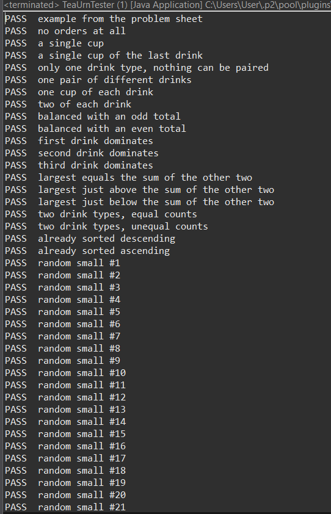
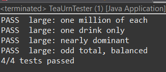
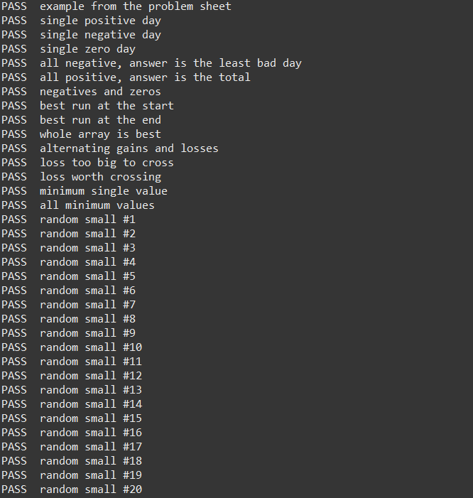
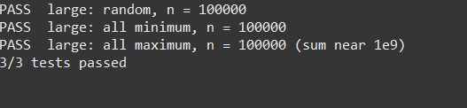
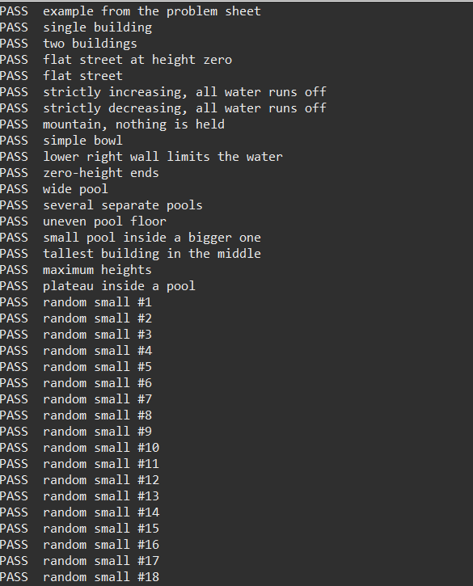
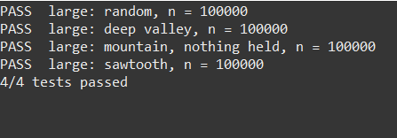

# CS341 Mini Project: Tiered Array Problem Set

*Student:* Baya Masmoudi

## Problems chosen

| Problem | Level | Points |
|---|---|---|
| 1A Tea Urn Rush | Easy | 20 |
| 3B Food Truck's Best Run | Medium | 40 |
| 1C Rooftop Puddles | Hard | 60 |
| *Total* | 1 Easy + 1 Medium + 1 Hard | *120* |

## Project structure

- src/teaurnrush/ : TeaUrnRush.java (solutions), TeaUrnTester.java (tester)
- src/foodtruck/ : FoodTruck.java (solutions), FoodTruckTester.java (tester)
- src/rooftopPuddles/ : RooftopPuddles.java (solutions), RooftopPuddlesTester.java (tester)
- tests/ : test files from the student kit
- screenshots/ : screenshots of the test runs

## 1A Tea Urn Rush (Easy)

*Brute force: minute-by-minute simulation.*
Each minute, pour one cup from the drink with the most cups left and one
cup from a different drink with the second most cups left, until every
cup is poured.

- Time: O(T), where T is the total number of cups (each minute does constant work over 3 drinks)
- Space: O(1)

*Optimized: formula.*
The answer is max(largest, ceil(total / 2)).
The urn pours at most 2 cups per minute, so at least ceil(total / 2)
minutes are needed. It cannot pour two cups of the same drink at once,
so at least largest minutes are needed. The larger of these two lower
bounds can always be reached.
- Time: O(1)
- Space: O(1)

---

## 3B Food Truck's Best Run (Medium)

*Brute force: try every streak.*
For every starting day, extend the streak one day at a time while keeping
a running sum, and remember the best sum seen.
- Time: O(n²)
- Space: O(1)

*Optimized: Kadane's algorithm.*
Keep current, the best streak ending at day i. At each day, either
continue the previous streak or start a new one at day i:
current = max(profit[i], current + profit[i]).
A streak with a negative total can only hurt what comes after it, so it
is dropped. best starts at profit[0], which handles the case where
every day is a loss.
- Time: O(n)
- Space: O(1)

---

## 1C Rooftop Puddles (Hard)

*Brute force: scan both sides for every building.*
The water above building i is min(tallest on the left, tallest on the right) - heights[i].
For each building, scan the whole left side and the whole right side to
find these two maximums.
- Time: O(n²)
- Space: O(1)

*Intermediate idea (not submitted):* precompute leftMax[] and
rightMax[] arrays in two passes. This gives O(n) time but uses O(n)
extra space.

*Optimized: two pointers.*
Start one pointer at each end and keep leftMax and rightMax.
If heights[left] < heights[right], a wall at least as tall exists on
the right, so the water at left depends only on leftMax: add it and
move left inward. Otherwise, do the same on the right side.
This improves on the intermediate idea by using constant space.
- Time: O(n)
- Space: O(1)

---

## How to run the tests

1. Open a tester class (TeaUrnTester, FoodTruckTester or RooftopPuddlesTester).
2. Right-click, then *Run As → Java Application*.
3. The console prints PASS or FAIL for each case, then the total.

For the _large test files, change fileName to the large file and set
runBrute = false. The brute force solutions are O(n²), which is too
slow for arrays of 100,000 elements. The large files show that the
optimized solutions run in linear time.

## Results

Both the brute force and the optimized solutions pass all the tests in
the regular test files, and the optimized solutions pass all the tests
in the large test files.

### 1A Tea Urn Rush

### 3B Food Truck's Best Run

### 1C Rooftop Puddles

